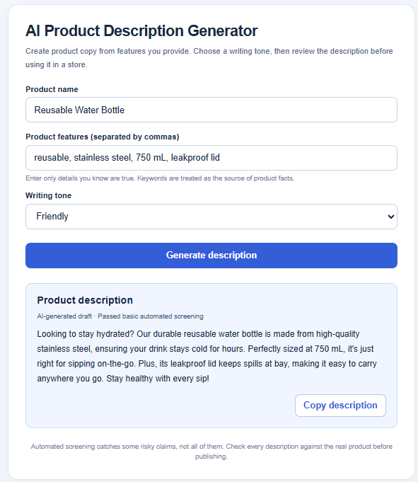
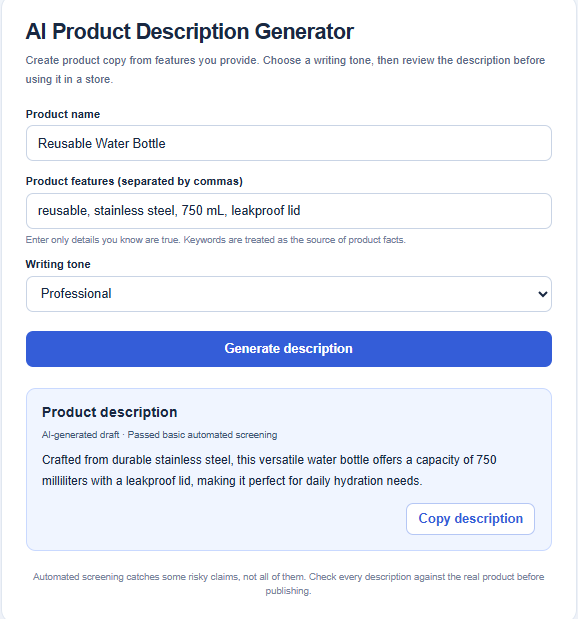
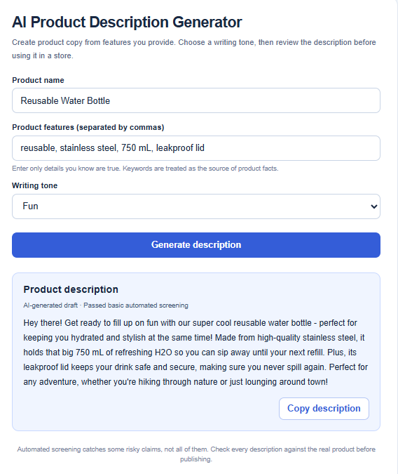
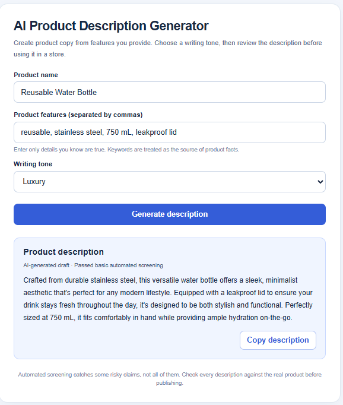

# AI-Powered Product Description Generator

## Project Overview

This project explores how generative AI can support retail and e-commerce by creating personalized product descriptions. The application uses a small Qwen language model through Hugging Face Transformers to generate descriptions based on a product name, keywords, and a selected writing tone. I developed the application using Python and Flask in Google Colab to demonstrate how businesses can use language models to create marketing content for different customer audiences.

## Application Features

- **Product Input** – Users can enter a product name and comma-separated keywords describing its features.
- **AI-Generated Descriptions** – A Qwen language model creates product descriptions based on the provided information.
- **Tone Selection** – Users can choose between Friendly, Professional, Fun, and Luxury writing styles.
- **Claim Screening** – The application checks for certain unsupported marketing claims and attempts to improve descriptions when it detects potential issues.
- **Fallback Descriptions** – If the screening system continues detecting problems, the application provides a simpler description based on the supplied features.
- **User-Friendly Interface** – The Flask webpage displays generated descriptions and allows users to copy the results.

## Technologies Used

- Python
- Flask
- Hugging Face Transformers
- Qwen2.5-Instruct
- PyTorch
- HTML and CSS
- Google Colab

## How to Run the Application

1. Open [Google Colab](https://colab.research.google.com/).
2. Upload the project's `.ipynb` notebook.
3. Run the cells in order to install the required libraries, create the Flask application, and load the language model.
4. Navigate to the section that launches the Flask application.
5. Use the embedded webpage in Colab to enter product information, select a writing tone, and generate a description.

The application uses a public Hugging Face model, so no paid API key is required. Google Colab can run the model on a CPU or GPU, although GPU execution generally provides faster results.

## Application Testing

I tested the application using different products, including reusable water bottles and wireless Bluetooth headphones. These tests helped me compare how the language model responded to different keywords and writing tones. Some descriptions included unsupported product claims, which led me to experiment with prompt engineering and add a basic automated screening system. The notebook includes additional tests for input validation, claim screening, and fallback behavior.

### Screenshots of Writing Tones

**Friendly**

**Professional**

**Fun**

**Luxury**

## Limitations and Future Improvements

Although the application generates descriptions in different writing styles, the language model can occasionally introduce details that the user never provided. The automated screening system helps identify certain questionable claims, but it cannot guarantee complete accuracy. A future improvement could involve connecting the application to a verified product database and developing a more reliable fact-checking system.

## Conclusion

This project demonstrates how language models can help businesses create personalized content for online stores. It provided practical experience with Flask, Hugging Face Transformers, and prompt engineering while highlighting the importance of accuracy and human review when using generative AI in retail.
